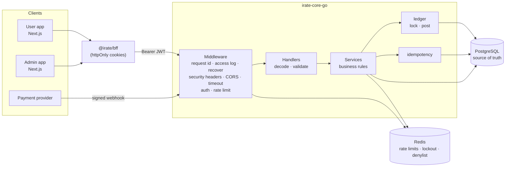

# iRate Core (Go)

[](https://github.com/iamBlissMedik/irate-core-go/actions/workflows/ci.yml)
[](go.mod)
[](migrations)
[](api/openapi.yaml)

A production-style **fintech wallet and ledger API** in Go: accounts, KYC,
peer-to-peer transfers, card deposits (Paystack), and an admin back office,
built on a **double-entry ledger** with **row-level locking** and
**database-backed idempotency**.

It is a ground-up rewrite of the original Express/Prisma backend
([iamBlissMedik/irate-core](https://github.com/iamBlissMedik/irate-core)) and
keeps its HTTP contract, so the Next.js user and admin apps in
[iamBlissMedik/iRate](https://github.com/iamBlissMedik/iRate) (`@irate/contracts`,
`@irate/bff`) work against it unchanged. That was verified end to end: every
response through the BFF was checked against the frontend's zod contracts, and
a real browser drove the UI. The rewrite also fixes a set of correctness and
security issues in the original; see
[docs/MIGRATING-FROM-EXPRESS.md](docs/MIGRATING-FROM-EXPRESS.md).

---

## Contents

- [Highlights](#highlights)
- [Architecture](#architecture)
- [Quick start](#quick-start)
- [How money moves](#how-money-moves)
- [Security model](#security-model)
- [API overview](#api-overview)
- [Configuration](#configuration)
- [Testing](#testing)
- [Project layout](#project-layout)
- [Design decisions](#design-decisions)
- [Roadmap](#roadmap)

## Highlights

| Area | What it does |
| --- | --- |
| **Ledger** | Every movement is a balanced double-entry journal. Postgres enforces it: a deferred trigger rejects unbalanced journals at `COMMIT`, ledger rows are append-only, and user balances have a `CHECK (balance >= 0)`. |
| **Concurrency** | Pessimistic `SELECT … FOR UPDATE` locking in a fixed order, so transfers can't overdraw or deadlock. Integration tests run 50 concurrent transfers and opposite-direction storms under `-race`. |
| **Idempotency** | `Idempotency-Key` is stored in the **same transaction** as the money movement. Retries replay the original response, a key reused with a different payload is rejected, and keys are scoped per user. |
| **Payments** | A `Provider` interface with two implementations: **Paystack** (hosted checkout, HMAC-SHA512 webhooks, server-to-server verification before every credit) and a signed **sandbox** for local testing. Webhooks are de-duplicated and credit each deposit exactly once. |
| **Auth** | 15-minute JWTs (key rotation via `kid`), plus opaque refresh tokens stored hashed and **rotated on every use**. Refresh-token reuse detection revokes the whole session family. Logout-all, a Redis denylist, argon2id hashing, and login lockout. |
| **KYC** | Compare-and-set state machine (PENDING → VERIFIED/REJECTED). Tiered limits: unverified users have a daily transfer cap, checked under the wallet lock. |
| **Operations** | Structured `slog` logs with request ids, Prometheus metrics on an internal port, liveness/readiness probes, graceful shutdown, statement and lock timeouts, a leader-elected janitor, and a ledger reconciliation endpoint. |
| **Tooling** | sqlc (type-safe SQL, no ORM), goose migrations embedded in the binary, a distroless Docker image, docker-compose, golangci-lint, GitHub Actions CI, an OpenAPI 3.1 spec. |

## Architecture



**Layers.** Each feature package (`auth`, `wallet`, `transfer`, `kyc`, `payment`,
`admin`, …) owns its handler (HTTP only), service (business rules, returns
typed `apperr` errors) and SQL queries. Money moves in exactly one place,
`internal/ledger`. `internal/app` is the composition root: every dependency
is constructed explicitly, with no DI framework and no globals.

**State.** PostgreSQL holds everything that matters: balances, ledger,
sessions, idempotency records and audit logs. Redis holds only
short-lived state that can be rebuilt (rate-limit counters, login failures,
the access-token denylist), so losing Redis never loses or duplicates money.

More detail: [docs/ARCHITECTURE.md](docs/ARCHITECTURE.md).

## Quick start

**Prerequisites:** Go 1.26+, plus either Docker, or a local PostgreSQL 14+ and Redis 6.2+.

### Option A: Docker (everything included)

```bash
docker compose up --build -d          # Postgres, Redis, migrations, API
docker compose run --rm seed          # demo users and balances
curl localhost:8000/readyz            # {"status":"ready",...}
```

### Option B: local Postgres and Redis

```bash
cp .env.example .env                  # edit DATABASE_URL if needed
createdb irate_core_go
make tools                            # sqlc + golangci-lint
make migrate-up
make seed
make run                              # http://localhost:8000
```

### Demo data (`make seed`)

| Role | Email | Password | Account | Balance |
| --- | --- | --- | --- | --- |
| ADMIN | admin@irate.dev | `Admin123!` | – | – |
| USER | ada@irate.dev | `Password123!` | `1000000001` | ₦48,000.00 (KYC verified) |
| USER | bola@irate.dev | `Password123!` | `1000000002` | ₦14,500.00 (KYC verified) |
| USER | chidi@irate.dev | `Password123!` | `1000000003` | ₦0.00 (no KYC: daily limit applies) |

### Try a transfer

```bash
TOKEN=$(curl -s localhost:8000/api/v1/auth/login -H 'Content-Type: application/json' \
  -d '{"email":"ada@irate.dev","password":"Password123!"}' | jq -r .data.accessToken)

# 1. Name enquiry: who owns this account?
curl -s localhost:8000/api/v1/transactions/resolve/1000000002 -H "Authorization: Bearer $TOKEN"

# 2. Send NGN 2,500.00 (amounts are minor units: 250000 kobo)
KEY=$(uuidgen)
curl -s localhost:8000/api/v1/transactions/transfer -H "Authorization: Bearer $TOKEN" \
  -H 'Content-Type: application/json' -H "Idempotency-Key: $KEY" \
  -d '{"toAccountNumber":"1000000002","amount":250000,"note":"Rent share"}'

# 3. Retry with the same key: same response, header "Idempotent-Replayed: true", no second debit
```

### Point the Next.js apps at it

Both apps already speak this API. Set `IRATE_API_BASE_URL=http://localhost:8000/api/v1`
in the BFF environment (the default) and run the Go service on port 8000.

## How money moves

All amounts are **integer minor units** (kobo). The database stores them as
`BIGINT`, Go as `int64`, and JSON as **strings** (`"250000"`), so no JavaScript
client ever loses precision. Requests accept `250000` or `"250000"` and
reject `2500.50`, `2.5e5`, `"+5"` and anything that overflows int64.

A transfer is one database transaction:

```text
BEGIN
  claim Idempotency-Key            INSERT … ON CONFLICT DO NOTHING (replay if it exists)
  load sender + recipient wallets
  SELECT … FROM wallets WHERE id = ANY($1) ORDER BY id FOR UPDATE   -- fixed lock order: no deadlocks
  check: not frozen · balance ≥ amount · KYC daily limit            -- cannot race: rows are locked
  INSERT transactions               (journal header, unique reference TRF-…)
  UPDATE wallets balance ± amount   (debit sender, credit recipient)
  INSERT ledger_entries ×2          (exact balance_before / balance_after)
  INSERT audit_logs
  store idempotent response
COMMIT                              -- deferred trigger: debits = credits, or the whole thing aborts
```

Money that enters or leaves the platform uses **system accounts** as the other
side of the journal. A deposit debits `SETTLEMENT` and credits the user; an
admin credit debits `ADJUSTMENTS`. Across all wallets, every currency
therefore sums to exactly zero, and `GET /admin/reconciliation` checks that
together with two other invariants.

Full write-up: [docs/ARCHITECTURE.md#the-ledger](docs/ARCHITECTURE.md#the-ledger) and the ADRs.

## Security model

- **Browser never sees a token.** The Next.js BFF keeps tokens in httpOnly cookies and calls this API server-to-server.
- **Access tokens** are HS256 JWTs (15 min) with a pinned algorithm (blocks `alg=none` and algorithm confusion), issuer, audience and `kid`. `JWT_ACCESS_SECRET_PREVIOUS` allows zero-downtime key rotation.
- **Refresh tokens** are 256-bit random values in an `HttpOnly; Secure; SameSite=Strict` cookie scoped to `/api/v1/auth`, stored only as SHA-256 hashes, and rotated on every refresh. Presenting a rotated token outside a short grace window revokes the entire session family (stolen-token detection).
- **Revocation:** logout denylists the access token's `jti` in Redis until it expires. Logout-all revokes every session on every device. If Redis is unreachable, authentication fails closed (503).
- **Passwords:** argon2id (OWASP parameters), with a concurrency cap so login floods can't exhaust memory, constant-time comparison, a dummy hash for unknown emails (no timing oracle), and transparent re-hashing when parameters change.
- **Brute force:** per-email lockout (failures only, emails hashed in Redis), plus per-IP limits on credential endpoints.
- **Rate limiting:** Redis GCRA, per user for authenticated routes (works behind the BFF, where every request shares one IP), per IP for anonymous routes, and tighter limits on transfers and name enquiry (anti-scraping). Fails open, because it protects capacity rather than correctness.
- **Authorization:** role middleware for `/admin/*`. Ownership checks return 404 for other users' wallets (no existence oracle). Admins can't credit their own wallet or review their own KYC.
- **Input:** strict JSON (unknown fields, wrong types, trailing data and bodies over 1 MiB are rejected), validation with per-field errors, LIKE-wildcard escaping in search, and control-character rejection in names and notes.
- **Transport and headers:** `Cache-Control: no-store` on every response, HSTS in production, CSP, an exact CORS allowlist, and `X-Forwarded-For` trusted only for a configured number of proxy hops.
- **Production guardrails:** startup refuses missing or weak secrets, insecure cookies, wildcard CORS, and sandbox simulation in production.

## API overview

Base path `/api/v1`. Responses use `{ "success", "message", "data" }`. Errors
use `{ "success": false, "message", "code", "errors": [{field,message}], "requestId" }`.
The full spec is in [api/openapi.yaml](api/openapi.yaml) (import it into Postman or Insomnia).

🔒 bearer token · 👑 ADMIN · 🔑 `Idempotency-Key` required

| Method | Path | | Description |
| --- | --- | --- | --- |
| POST | `/auth/register` | | Create a user and wallet; returns the account number |
| POST | `/auth/login` | | Access token (body) and refresh token (cookie) |
| POST | `/auth/refresh` | 🍪 | Rotate the refresh token, issue a new access token |
| POST | `/auth/logout` | | End this session (access token and/or cookie) |
| POST | `/auth/logout-all` | 🔒 | End every session on every device |
| GET | `/users/me` · `/users/me/overview` · `/users/{id}` | 🔒 | Profile, home-screen overview, profile by id (self or admin) |
| POST · GET | `/wallets` | 🔒 | Open a wallet (per currency) · list mine |
| GET | `/wallets/{id}/balance` | 🔒 | Balance (owner only) |
| GET | `/transactions/resolve/{accountNumber}` | 🔒 | Name enquiry |
| POST | `/transactions/transfer` | 🔒🔑 | Send money by account number |
| GET | `/transactions/me` · `/transactions/{walletId}/transactions` | 🔒 | Statements |
| POST · GET | `/kyc/submit` · `/kyc/status` | 🔒 | Submit / view KYC |
| POST | `/payments/deposits` | 🔒🔑 | Start a card deposit (returns a checkout URL) |
| GET | `/payments/deposits` · `/payments/deposits/{id}` | 🔒 | Deposit history / status |
| POST | `/payments/sandbox/deposits/{id}/simulate` | 🔒 | Dev only: play the provider |
| POST | `/webhooks/payments/{provider}` | sig | Provider webhooks (HMAC-verified) |
| GET | `/admin/dashboard/overview` · `/admin/users/stats` · `/admin/wallets/balance` | 👑 | Dashboard stat cards |
| GET | `/admin/users` · `/admin/me` | 👑 | User directory (search, pagination) · own profile |
| POST | `/admin/credit/{walletId}` | 👑🔑 | Credit a wallet (via `ADJUSTMENTS`) |
| PATCH | `/admin/wallets/{walletId}/status` | 👑 | Freeze / unfreeze (post-no-debit) |
| GET · PATCH | `/admin/kyc` · `/admin/kyc/{id}/review` | 👑 | KYC queue · approve/reject |
| GET | `/admin/reconciliation` | 👑 | Ledger invariant check |

Probes: `GET /healthz` (liveness), `GET /readyz` (Postgres and Redis, and 503 while draining).
Metrics: `GET :9090/metrics` (internal port).

## Configuration

Everything comes from environment variables; [.env.example](.env.example)
documents every one. The most important:

| Variable | Default | Notes |
| --- | --- | --- |
| `DATABASE_URL` | **required** | PostgreSQL connection string |
| `REDIS_URL` | `redis://127.0.0.1:6379/0` | |
| `JWT_ACCESS_SECRET` | dev default | **Required in production**, ≥ 32 chars |
| `PAYMENTS_PROVIDER` | `sandbox` | `sandbox` or `paystack` (with `PAYSTACK_SECRET_KEY`) |
| `SANDBOX_WEBHOOK_SECRET` | dev default | **Required in production** when the sandbox is the provider, ≥ 32 chars |
| `CORS_ALLOWED_ORIGINS` | `http://localhost:3000,http://localhost:9000` | Exact origins |
| `TRUSTED_PROXY_HOPS` | `0` | Set to `1` behind one load balancer |
| `UNVERIFIED_DAILY_TRANSFER_LIMIT_MINOR` | `5000000` | NGN 50,000 per day without KYC; `0` disables |
| `MAX_TRANSACTION_AMOUNT_MINOR` | `1000000000` | NGN 10,000,000 per transaction |
| `BUSINESS_TIMEZONE` | `Africa/Lagos` | Defines "today" for limits and stats |
| `AUTO_MIGRATE` | `false` | Migrate on boot (advisory-locked, safe with replicas) |

Invalid configuration fails at startup with **every** problem listed at once.

## Testing

```bash
make test               # unit tests, race detector, no infrastructure (miniredis)
make test-integration   # full HTTP suite against real Postgres and Redis (TEST_* in .env)
make cover              # combined coverage report → coverage.html
make lint               # golangci-lint
```

The integration suite (`internal/integration`) drives the real router over
HTTP and proves the guarantees that matter:

- 50 concurrent transfers against a balance that covers 20: **exactly 20 succeed**, the balance ends at 0, and the ledger reconciles.
- 60 transfers in both directions between the same wallets: **no deadlocks**, money conserved.
- 20 simultaneous requests with one `Idempotency-Key`: **one debit**, 19 replays, identical responses.
- 20 concurrent webhook deliveries for one deposit: **credited once**.
- Refresh-token rotation, race tolerance and theft detection. Logout and logout-all.
- Lockout, IDOR checks, KYC state machine with concurrent reviews, daily limits, frozen wallets, amount-mismatch webhooks, the append-only ledger at the DB level.

Coverage: ~76% of statements overall, 85–93% for the money paths (ledger, transfer, idempotency, KYC).

## Project layout

```text
cmd/
  api/          HTTP server
  migrate/      goose migrations (up, down, status…), needs only DATABASE_URL
  seed/         demo data via real domain code (refuses in production)
migrations/     SQL schema, embedded into the binaries
api/            OpenAPI 3.1 spec
internal/
  app/          composition root: wiring, router, lifecycle, probes
  config/       env loading and validation
  auth/         register/login/refresh/logout, JWT, argon2id, lockout, denylist, middleware
  wallet/       wallets, balances, account numbers, name enquiry
  ledger/       THE place money moves: lock + balanced posting
  transfer/     P2P transfers, daily limits
  statement/    ledger entries → bank-statement lines
  kyc/          submission + review state machine
  payment/      provider interface, Paystack + sandbox providers, deposits, webhooks
  admin/        dashboard stats, credits, freeze, reconciliation
  user/         profiles, overview, admin directory
  idempotency/  transactional idempotency keys
  audit/        in-transaction audit log
  ratelimit/    Redis GCRA middleware
  jobs/         janitor (advisory-lock leader election)
  httpx/        envelope, strict decoding, validation, pagination, middleware
  apperr/       typed client-facing errors and codes
  money/        minor-unit type (JSON string, strict parsing), formatting
  reqctx/       request-scoped values (principal, request id, IP)
  platform/     database (pool, tx + retry), redis, logging, metrics, migrations
  db/           sqlc-generated code (+ queries/*.sql, the only SQL in the app)
  integration/  end-to-end tests (build tag: integration)
docs/           architecture, ADRs, payments, migration notes, module recipe
```

## Design decisions

Architecture Decision Records in [docs/adr](docs/adr):

1. [Double-entry ledger with database-enforced invariants](docs/adr/0001-double-entry-ledger.md)
2. [Pessimistic row locking with ordered acquisition](docs/adr/0002-pessimistic-locking.md)
3. [Idempotency keys in the same Postgres transaction](docs/adr/0003-transactional-idempotency.md)
4. [Rotating refresh tokens with reuse detection](docs/adr/0004-refresh-token-rotation.md)
5. [sqlc instead of an ORM](docs/adr/0005-sqlc-over-orm.md)
6. [Redis only for disposable state](docs/adr/0006-redis-for-disposable-state.md)

Adding a feature? Follow [docs/ADDING-A-MODULE.md](docs/ADDING-A-MODULE.md).
Payments, Paystack setup and adding providers: [docs/PAYMENTS.md](docs/PAYMENTS.md).

## Roadmap

- **Payouts (withdrawals to bank):** hold funds in a `PAYOUTS_PENDING` system account at request time, settle or reverse on the provider webhook (design in [docs/PAYMENTS.md](docs/PAYMENTS.md)).
- **More providers:** Flutterwave/Stripe adapters, plus a reconciliation job that cross-checks provider settlement reports.
- **Transactional outbox** for domain events (email/push notifications, analytics) with at-least-once delivery.
- **Fees and multi-currency:** the posting engine already supports N-legged journals and per-currency system accounts.
- **Keyset pagination** for statements at very high volume, and table partitioning of `ledger_entries` by month.
- **OpenTelemetry tracing** across the BFF and API (request ids already propagate).
- **Step-up auth / transaction PIN** for transfers above a threshold.
